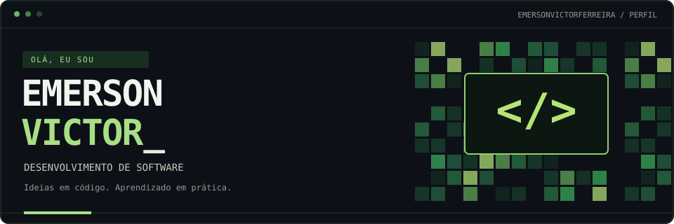

  

  <a href="#quem-sou">Quem sou</a> ·
  <a href="#o-que-construo">O que construo</a> ·
  <a href="#projetos-em-destaque">Projetos</a> ·
  <a href="#tecnologias">Tecnologias</a> ·
  <a href="#vamos-conversar">Contato</a>

## Quem sou

Olá! Sou **Emerson Victor**, tecnólogo em **Análise e Desenvolvimento de Sistemas**.

Gosto de transformar ideias em soluções práticas e aprender construindo. Meus projetos passam por desenvolvimento de sistemas, aplicações web, APIs e automações — conectando fundamentos de programação a problemas do dia a dia.

## O que construo

- **Sistemas e aplicações:** ferramentas para organizar informações e simplificar rotinas.
- **Integrações e automações:** conexões entre serviços para reduzir tarefas repetitivas.
- **Projetos acadêmicos e pessoais:** espaço para experimentar, estudar e evoluir a cada versão.

## Minha visão

Construir soluções úteis, entender como elas funcionam e melhorar continuamente. Para mim, cada projeto é uma oportunidade de aprender e colocar conhecimento em prática.

## Além do código

Também exploro **impressão 3D e projetos maker** na Tekro 3D, unindo tecnologia, criatividade e soluções para o mundo físico.

## Projetos em destaque

| Projeto | Proposta | Repositório |
| :--- | :--- | :--- |
| **HelpSeek · API** | API em ASP.NET Core para integração entre aplicações desktop, web e mobile. | [Explorar código ↗](https://github.com/emersonvictorferreira/HelpSeek-API) |
| **HelpSeek · Web** | Interface web do projeto HelpSeek. | [Explorar código ↗](https://github.com/emersonvictorferreira/HelpSeek-Web) |
| **HelpSeek · Android** | Aplicativo Android do projeto HelpSeek. | [Explorar código ↗](https://github.com/emersonvictorferreira/HelpSeek-Mobile-Android) |

  <a href="https://github.com/emersonvictorferreira?tab=repositories">Ver meus repositórios públicos →</a>

## Tecnologias

  

  HTML5 e CSS3 · Git e GitHub · Em aprendizado: Python, C e Linux

## Atividade em código

<!-- CONTRIBUICOES_3D -->

[Ver minhas contribuições no GitHub →](https://github.com/emersonvictorferreira?tab=overview)

## Vamos conversar?

  
  

  Aprender. Construir. Melhorar. Repetir.

