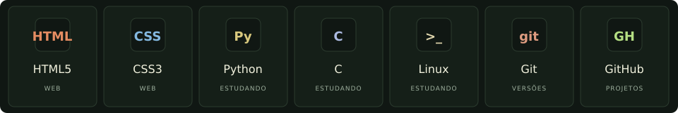
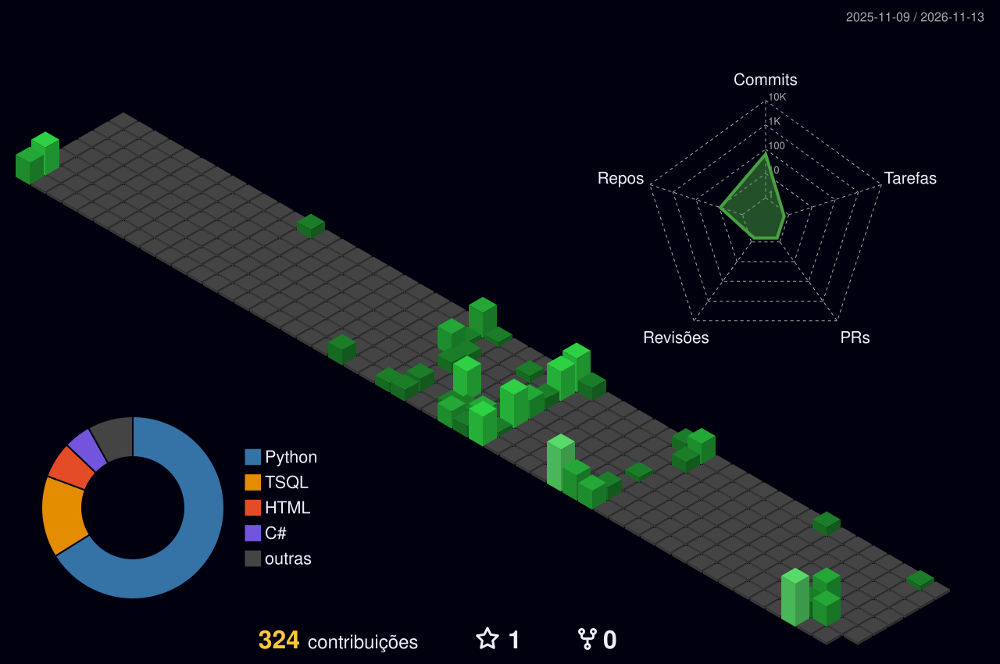

  

 

Sou **Emerson Victor**, tecnólogo em **Análise e Desenvolvimento de Sistemas**. Gosto de entender como as coisas funcionam e transformar esse aprendizado em soluções práticas.

Meu foco está em **sistemas, aplicações web, APIs e automações**. Aqui compartilho projetos acadêmicos e pessoais, experimentos e minha evolução no desenvolvimento.

- **O que me move:** criar ferramentas úteis e simplificar tarefas do dia a dia.
- **Como aprendo:** construindo, testando e melhorando a cada versão.
- **Além do código:** impressão 3D e projetos maker na **Tekro 3D**.

 

  <a href="https://github.com/emersonvictorferreira?tab=repositories">Explorar todos os repositórios públicos ↗</a>

 

 

  

  <a href="https://github.com/emersonvictorferreira?tab=overview">Acompanhar minhas contribuições ↗</a>

 

 

